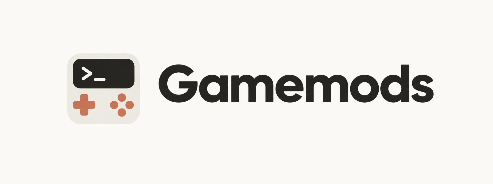
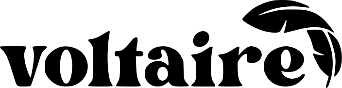
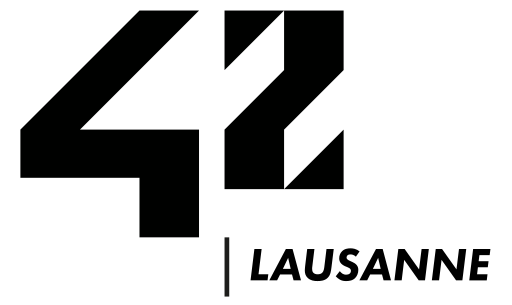
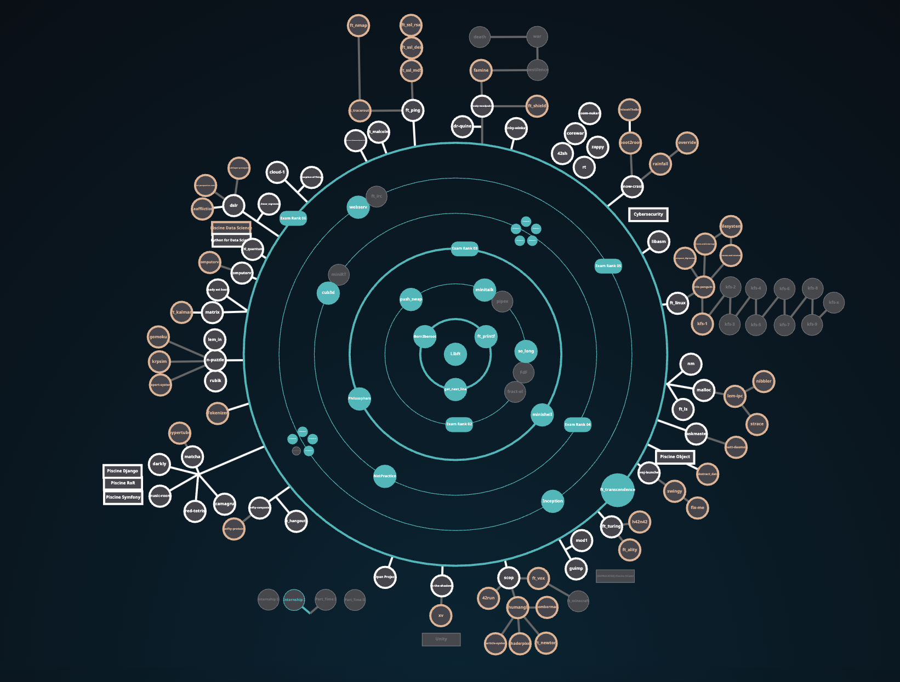

# Hi there! I'm Bima, or Tanguy 👋

Software engineer, leaning hard into **AI engineering** and **backend systems**.
I like building systems that last: LLM-powered products that hold up in production, on an architecture made to iterate.

Wait, not so fast! I'll leave you with a brief summary of my current situation before going into more detail.

- 💻 Senior Software Engineer at [Le Labster](https://www.labster.io/), designing custom AI solutions built into our clients' workflows. Lately: using AI to speed up and raise the quality of design production.
- 🐙 Co-founder of [Bidium](https://bidium.pro) with [Widium](https://github.com/widium) and [Yvanoff](https://github.com/YvanoffP): we integrate specialized AI into businesses, to solve the problems that cost them every month.
- 🧭 Always leveling up, toward bigger scope: system design, technical direction, and helping the people around me ship better.
- 🎓 Still connected to the amazing [42 Lausanne School](https://42lausanne.ch/#temoignages) where learning never stops.

Always up for a chat about tech, startups, or any other fascinating subject, so feel free to add me on [LinkedIn](https://www.linkedin.com/in/tanguy-pauvret/)

## Bidium

  <a href="https://bidium.pro" target="_blank">
    <picture>
      <source media="(prefers-color-scheme: dark)" srcset="./resources/bidium-logo-white.svg">
      
    </picture>
  </a>

Bidium is the agency I'm building with two friends. Off-the-shelf tools are made for the average business; we work on the problems they leave unsolved, with specialized AI integrated into the business. See what we do on [our website](https://bidium.pro).

## Side Projects Farm 🧑‍🌾

<table style="width: 100%; border-collapse: collapse; border-color: transparent">
  <tr>
  <td width="50%" align="center">
    
  </td>
    <td width="50%" align="center">
      
    </td>
  </tr>
  <tr>
      <td width="50%" align="center">
        
      </td>
    <td width="50%" align="center">
      
    </td>
  </tr>
</table>

And the seeds still growing:

- #### [Gallery](https://github.com/Bidium-org/gallery): an infinite canvas for image generation. Plug in any model, and let any AI agent work on it
- #### [Knower](https://github.com/Bidium-org/knower): a local, portable memory layer every AI agent can share. Mistral Online Hackathon
- #### [MCP Mem](https://github.com/Bima42/mcp-mem): memory layer for LLMs, built on Neo4j. Singapore Cursor Hackathon, Smithery Prize
- #### [jstream-py](https://github.com/Bima42/jstream-py): turn a raw LLM token stream into validated JSON objects as fields complete
- #### [Healthspector](https://github.com/Bima42/healthspector): AI-powered pain mapping on a 3D body model. Hamburg Cursor Hackathon
- #### [42 Projects](https://github.com/Bima42/42-projects-overview) and a [maze generator](https://github.com/Bima42/cub3d_map_generator) for the [42 Cub3D project](https://github.com/Bima42/cub3d)

## Writing

- ✍️ [My blog](https://tanguypauvret.me/en/blog): technical write-ups, the architecture choices I make, good and bad.
- 🐙 [Bidium's blog](https://bidium.pro/en/blog): what AI changes for a business, told for the people who run it.

## Where I Come From

It has been a wild ride. A Bachelor in Neurosciences, four years in professional kitchens, then a sharp turn into tech thanks to [42 Lausanne School](https://42lausanne.ch/#temoignages), driven by an insatiable curiosity and a knack for problem-solving.

<table style="width: 75%; margin-left: auto; margin-right: auto;">
  <tr>
    <td>
      
    </td>
    <td>
      
    </td>
  </tr>
</table>

The school is like Hogwarts for developers—minus the magic wands, but with a lot more coding. Here's how this unique environment helped me evolve:

- At 42, I didn't just learn to code; I learned to think like an innovator and quickly find a solution to a problem.
- The diverse projects helped me discover my passion for building products end to end, and the thrill of startup life.
- Working with a community of motivated peers taught me the value of teamwork and how to collaborate effectively, even remotely and under tight deadlines.

Then came Resilio, from intern to technical lead on ResilioTech: architecture overhaul, migration plans, an analytics stack, onboarding new developers and strict peer review. That's where I learned to make architecture decisions under real pressure, and that's the path I keep following.
