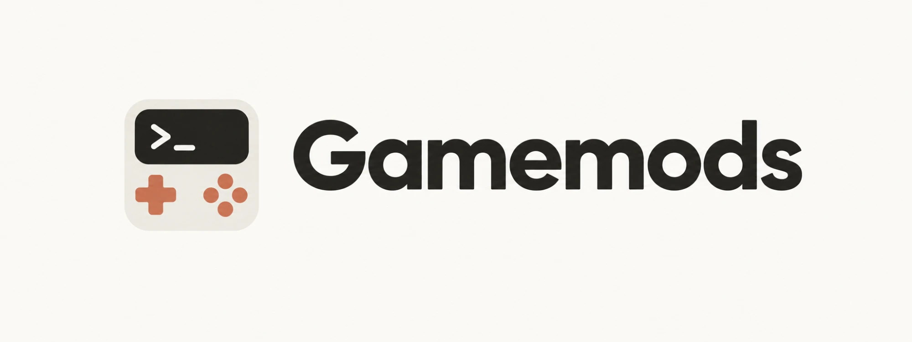
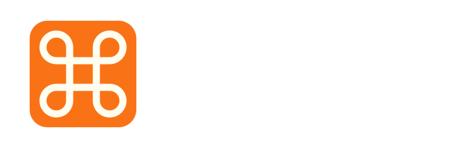
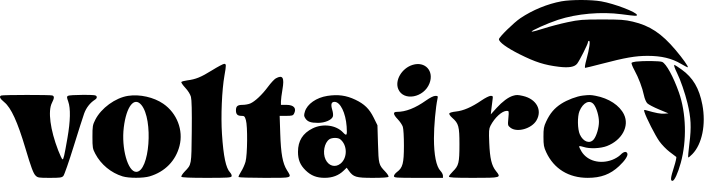
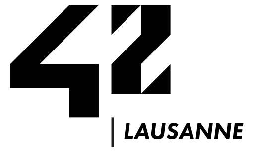
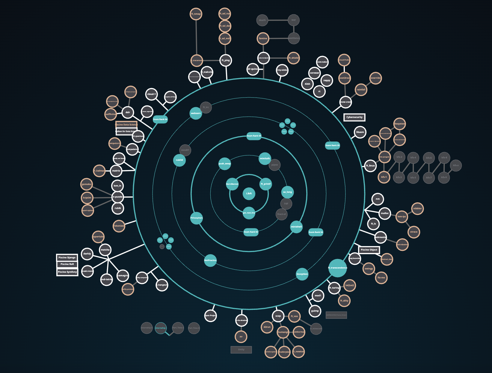

# Hi there! I'm Bima, or Tanguy 👋

Senior software engineer at [Le Labster](https://www.labster.io/), leaning more and more toward AI engineering and architecture.
My mates say I'm as absurd as I am smart. I'll take it.

I learn a lot from working with people far more experienced than me, and just as much from people who are starting out. Both keep putting me back in my place, something 42 taught me early. And I keep passing on what I know, the way others did for me and still do.

## What I do

At Le Labster, I design custom AI solutions built into our clients' workflows. Lately I've been using AI to speed up design production and raise its quality.

AI came into my life pretty early, thanks to [Widium](https://github.com/widium), who was already deep into machine learning back in 2022. I brought it into my workflow almost right away and never stopped. I've tried a ridiculous number of LLMs and built a lot of projects along the way, and more than anything it blew up my curiosity and my urge to build things.

Working together, each of us slowly found our place. Mine turned out to be architecture, along with everything around performance and observability. That's what led to [Bidium](https://bidium.pro), the agency [Widium](https://github.com/widium), [Yvanoff](https://github.com/YvanoffP) and I started together. We bring specialized AI into businesses, for the problems that cost them every month.

  <a href="https://bidium.pro" target="_blank">
    <picture>
      <source media="(prefers-color-scheme: dark)" srcset="./resources/bidium-logo-white.svg">
      
    </picture>
  </a>

## Side Projects Farm 🧑‍🌾

<table style="width: 100%; border-collapse: collapse; border-color: transparent">
  <tr>
  <td width="50%" align="center">
    
  </td>
    <td width="50%" align="center">
      
    </td>
  </tr>
  <tr>
      <td width="50%" align="center">
        
      </td>
    <td width="50%" align="center">
      
    </td>
  </tr>
</table>

And the seeds still growing:

- #### [Gallery](https://github.com/Bidium-org/gallery): an infinite canvas for image generation. Plug in any model, and let any AI agent work on it
- #### [Knower](https://github.com/Bidium-org/mistral-hackathon): a local, portable memory layer every AI agent can share. Mistral Online Hackathon
- #### [MCP Mem](https://github.com/Bima42/mcp-mem): memory layer for LLMs, built on Neo4j. Singapore Cursor Hackathon, Smithery Prize
- #### [jstream-py](https://github.com/Bima42/jstream-py): turn a raw LLM token stream into validated JSON objects as fields complete
- #### [Healthspector](https://github.com/Bima42/healthspector): AI-powered pain mapping on a 3D body model. Hamburg Cursor Hackathon
- #### [42 Projects](https://github.com/Bima42/42-projects-overview) and a [maze generator](https://github.com/Bima42/cub3d_map_generator) for the [42 Cub3D project](https://github.com/Bima42/cub3d)

## Writing

- ✍️ [My blog](https://tanguypauvret.me/en/blog): technical write-ups, the architecture choices I make, good and bad.
- 🐙 [Bidium's blog](https://bidium.pro/en/blog): what AI changes for a business, told for the people who run it.

## Where I Come From

A bachelor in neuroscience, four years in professional kitchens, then a sharp turn into tech at [42 Lausanne](https://42lausanne.ch/#temoignages), driven by an insatiable curiosity and a real taste for solving problems.

<table style="width: 75%; margin-left: auto; margin-right: auto;">
  <tr>
    <td>
      
    </td>
    <td>
      
    </td>
  </tr>
</table>

Always up for a chat about tech, startups, or any other fascinating subject, so feel free to add me on [LinkedIn](https://www.linkedin.com/in/tanguy-pauvret/).
